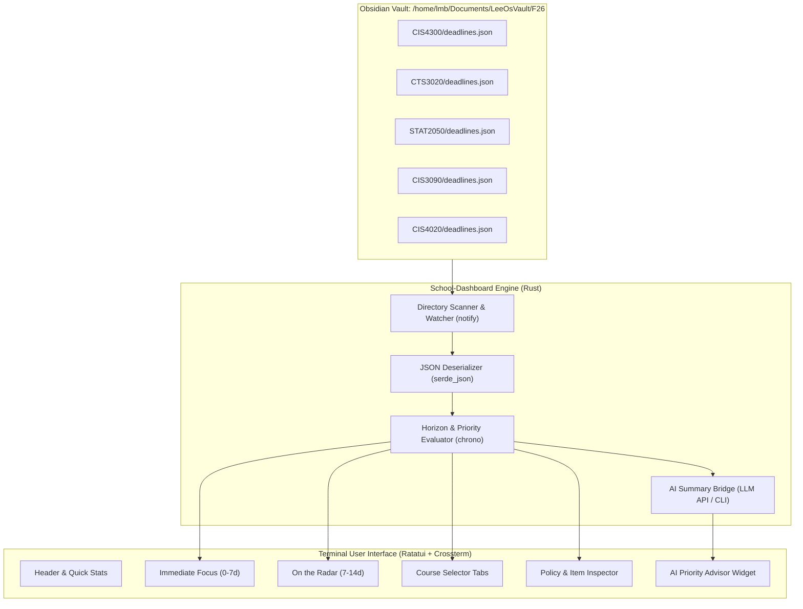

# School-Dashboard: Technical Architecture & UX/UI Design Specification

> **Status:** Living Discussion & Architecture Document  
> **Target Date Context:** Fall 2026 Semester  
> **Vault Root:** `/home/lmb/Documents/LeeOsVault/F26`  
> **Stack:** Rust, Ratatui, Crossterm, Serde  

---

## 1. Executive Summary & Design Vision

### 1.1 The Core Problem
The current Obsidian-based workflow stores deadlines across individual `Deadlines.md` files in 5 course folders (`CIS4300`, `CTS3020`, `STAT2050`, `CIS3090`, `CIS4020`). 
- **Cognitive Overload:** Scanning long markdown files with 20+ chronological entries causes friction and analysis paralysis.
- **Noise vs. Signal:** Deadlines in late November or December distract from high-urgency deliverables due within the next 48 hours or week.
- **Fragmented Context:** Late policies, submission platforms (CourseLink vs. SOCS Moodle vs. In-class), and weighting are buried in separate documents.

### 1.2 The Solution
A dedicated **Ratatui-based Terminal User Interface (TUI)** that acts as a cockpit for your academic term:
1. **Horizon-Based Filtering (The 7–12 Day Window):** Only shows what actually demands action now or in the immediate forecast.
2. **Type-Aware Lead Times:** Exams demand a 7–14 day preparation horizon, while standard assignments/milestones trigger a 7–10 day warning.
3. **Glanceable Triad:**
   - **Urgent / Active (0–7 Days):** What is immediately due.
   - **On the Radar (7–14 Days):** Midterms and major milestones that require advance study or group coordination.
   - **Course Status Cards:** Real-time pulse of all 5 courses with active task counts.
4. **Interactive Detail Inspector:** Contextual card showing weights, grace days, late penalties, and submission destinations on hover/selection.
5. **AI Priority Advisor:** Built-in synthesis panel summarizing what you should tackle tonight or this weekend based on weights, deadlines, and current progress.

---

## 2. UX & UI Information Architecture

### 2.1 Visual Hierarchy & Mental Model
A developer opening their terminal needs instant answers to three questions within **300 milliseconds**:
1. *Is anything on fire right now (< 48 hours)?*
2. *What do I need to prepare for this week (7–12 days)?*
3. *What should I prioritize working on right now?*

```
+----------------------------------------------------------------------------------------------------+
|  [⚡ ACADEMIC COCKPIT]   Fall 2026   |   Tue, Sep 29, 2026 - 21:15   |   4 Active Tasks (1 Urgent) |
+----------------------------------------------------------------------------------------------------+
|  COURSES (Tab / 1-5)                                                                               |
|  [• CIS4300: HCI (1)]  [• CTS3020: Story (1)]  [• STAT2050: Stats (0)]  [• CIS3090: Par (1)]  ...   |
+---------------------------------------------------------+------------------------------------------+
|  🔥 IMMEDIATE FOCUS (0 - 7 Days)                       |  🤖 AI STRATEGIC ADVISOR                 |
|                                                         |                                          |
|  [!] CTS3020: Digital Storytelling Critique             |  "Focus first on wrapping up the         |
|      Due: Today @ 10:00 PM (45m left) | Weight: 20%     |  CTS3020 Critique (20%). Once submitted, |
|                                                         |  shift to CIS4020 A1 and CIS4300         |
|  [>] CIS4300: Milestone 1: Needfinding                  |  Milestone 1. Both fall on Oct 9."       |
|      Due: Oct 09 @ 11:59 PM (10d left) | Weight: 10%    |                                          |
|                                                         |  [Press 'a' to re-query advisor]         |
|  [>] CIS4020: Assignment 1                              +------------------------------------------+
|      Due: Oct 09 @ 5:00 PM (10d left)  | Weight: 15%    |  📋 ITEM DETAILS & POLICIES              |
|                                                         |                                          |
+---------------------------------------------------------+  Title: CIS4300 Milestone 1: Needfinding|
|  🔭 ON THE RADAR (7 - 14 Days)                          |  Course: CIS*4300 Human-Computer Inter.  |
|                                                         |  Due: Friday, Oct 09, 2026 @ 11:59 PM    |
|  [MIDTERM] STAT2050: Test 1 (Regression)                |  Weight: 10%                             |
|      Date: Fri, Oct 16 (17d left) | Weight: 20%         |  Platform: CourseLink Dropbox            |
|                                                         |  Grace Policy: 3 team grace days total   |
|  [PROJECT] CIS4020: Project Proposal                    |  Notes: Group deliverable (4-5 members). |
|      Due: Fri, Oct 16 @ 5:00 PM   | Weight: 5%          |         Needfinding guidelines in M1 doc.|
+---------------------------------------------------------+------------------------------------------+
|  [j/k] Navigate  [Space] Toggle Done  [Tab] Switch Pane  [a] AI Summary  [r] Reload  [q] Quit       |
+----------------------------------------------------------------------------------------------------+
```

### 2.2 Color Theory & Terminal Aesthetics
- **Theme Palette:** High-contrast modern dark palette (Catppuccin Mocha / Tokyo Night inspired):
  - **Urgent (< 48 hrs):** Bold Amber/Red (`#F38BA8` / `#FAB387`) with pulsing glyph `[!]`.
  - **Upcoming (3–7 days):** Yellow/Peach (`#F9E2AF`).
  - **On the Horizon (7–14 days):** Cyan/Sapphire (`#74C7EC` / `#89B4FA`).
  - **Completed:** Dim Muted Green (`#A6E3A1` with strikethrough/dim text).
  - **Exams/Tests:** Distinctive Magenta badge (`[EXAM]`) for immediate peripheral recognition.
- **Borders & Glyphs:** Rounded Unicode borders (`╭─╮╰─╯`), Nerd Font symbols (`󰃭` Calendar, `󰈸` Fire, `󰄬` Check, `` AI Sparkle, `󰌠` Warning).

### 2.3 Vim-Centric Interaction Model & Ergonomics
A terminal workflow is only as good as its muscle memory. Navigation follows standard Modal/Vim conventions:

#### 1. Modes & Status Indicator
- **NORMAL Mode:** Default navigation, browsing, inspection, and toggling.
- **SEARCH Mode (`/`):** Live fuzzy-filtering of all tasks across courses. `Esc` returns to NORMAL.
- **COMMAND Mode (`:`):** Neovim-style command palette (`:q`, `:reload`, `:ai`, `:open`).
- The bottom status bar features a Vim mode pill: ` NORMAL `, ` SEARCH `, or ` COMMAND `.

#### 2. Keymap Reference

| Keybinding | Scope | Action |
| :--- | :--- | :--- |
| `j` / `k` | List | Move down / up one item |
| `gg` / `G` | List | Jump to top / bottom of current list |
| `Ctrl-d` / `Ctrl-u` | List / Detail | Half-page scroll down / up |
| `h` / `l` or `Tab` | Panes | Switch focus between Focus, Horizon, AI Advisor, and Details |
| `Ctrl-w h/j/k/l` | Panes | Vim window motion across grid panes |
| `1` – `5` | Global | Fast course filter (1: CIS4300, 2: CTS3020, 3: STAT2050, 4: CIS3090, 5: CIS4020, `0`: All) |
| `<Space>` or `x` | Item | Toggle status (`todo` ⇄ `completed`) |
| `o` | Item | Open course LMS link (CourseLink / Moodle / Slack) in default browser |
| `e` | Item | Open `deadlines.json` in `$EDITOR` (Neovim) at the selected item, resuming TUI on exit |
| `a` | AI | Re-query / refresh the AI Strategic Advisor |
| `/` | Global | Enter search / filter mode |
| `r` | Global | Force reload all JSON files from vault |
| `?` | Global | Toggle interactive cheat sheet / help modal |
| `q` or `:q<CR>` | Global | Quit cleanly |

#### 3. Cursor & Focus Aesthetics
- **Cursor Line (`CursorLine`):** Highlighted with subtle background fill (`#313244`) and leading accent glyph (`▌` or `▶`).
- **Pane Focus:** Active pane gets a vibrant glowing border (Lavender `#B4BEFE` or Cyan `#89DCEB`) with bold title; unfocused panes remain muted (`#45475A`).


---

## 3. The Data Contract: `deadlines.json` Schema

### 3.1 Design Principles for the Contract
1. **Decoupled & Local:** Lives directly inside each course folder in your Obsidian vault (`/home/lmb/Documents/LeeOsVault/F26/{COURSE}/deadlines.json`).
2. **Zero Ambiguity:** Strongly-typed schema parsed with `serde_json`. No fragile regex scraping of markdown tables.
3. **Rich Metadata:** Stores assessment weights, submission platforms, and specific course late/grace policies so you never have to re-read syllabus PDFs.

### 3.2 JSON Schema Definition (`deadlines.schema.json`)

```json
{
  "$schema": "http://json-schema.org/draft-07/schema#",
  "title": "CourseDeadlines",
  "type": "object",
  "required": ["course_code", "course_name", "items"],
  "properties": {
    "course_code": { "type": "string", "example": "CIS*4300" },
    "course_name": { "type": "string", "example": "Human-Computer Interaction" },
    "instructor": { "type": "string", "example": "Prof. Yulia Kotseruba" },
    "color": { "type": "string", "example": "blue" },
    "links": {
      "type": "object",
      "properties": {
        "courselink": { "type": "string" },
        "moodle": { "type": "string" },
        "slack": { "type": "string" }
      }
    },
    "policies": {
      "type": "object",
      "properties": {
        "grace_days": { "type": "string" },
        "late_penalty": { "type": "string" },
        "exam_rule": { "type": "string" }
      }
    },
    "items": {
      "type": "array",
      "items": {
        "type": "object",
        "required": ["id", "title", "type", "due_date", "weight"],
        "properties": {
          "id": { "type": "string", "example": "cis4300-m1" },
          "title": { "type": "string", "example": "Milestone 1: Needfinding" },
          "type": {
            "type": "string",
            "enum": ["exam", "assignment", "project_milestone", "critique", "presentation", "admin"]
          },
          "due_date": {
            "type": "string",
            "format": "date-time",
            "example": "2026-10-09T23:59:00-04:00"
          },
          "weight": { "type": "number", "minimum": 0, "maximum": 100, "example": 10.0 },
          "status": {
            "type": "string",
            "enum": ["todo", "in_progress", "completed", "dropped"],
            "default": "todo"
          },
          "submission_platform": { "type": "string", "example": "CourseLink Dropbox" },
          "lead_time_days": {
            "type": "integer",
            "description": "Custom days in advance to display on dashboard. If omitted, uses type default.",
            "example": 14
          },
          "notes": { "type": "string", "example": "3 team grace days total for project." }
        }
      }
    }
  }
}
```

### 3.3 Concrete Course Examples (from your actual F26 syllabi)

#### Example A: `CIS4300/deadlines.json`
```json
{
  "course_code": "CIS*4300",
  "course_name": "Human-Computer Interaction",
  "instructor": "Prof. Yulia Kotseruba",
  "color": "cyan",
  "policies": {
    "grace_days": "3 grace days total for team project (M1-M3)",
    "late_penalty": "No late submissions accepted for individual assignments",
    "exam_rule": "Must obtain >= 50% on Final Exam to pass course"
  },
  "items": [
    {
      "id": "cis4300-m1",
      "title": "Milestone 1: Needfinding",
      "type": "project_milestone",
      "due_date": "2026-10-09T23:59:00-04:00",
      "weight": 10.0,
      "status": "todo",
      "submission_platform": "CourseLink Dropbox",
      "lead_time_days": 12,
      "notes": "Group deliverable (4-5 members). 3 grace days available for project."
    },
    {
      "id": "cis4300-midterm",
      "title": "Midterm Exam (In-Person)",
      "type": "exam",
      "due_date": "2026-11-02T09:30:00-04:00",
      "weight": 15.0,
      "status": "todo",
      "submission_platform": "In-Person (MCKN 117)",
      "lead_time_days": 14,
      "notes": "Closed-book during class. SAS booking deadline Nov 2."
    }
  ]
}
```

#### Example B: `CIS3090/deadlines.json`
```json
{
  "course_code": "CIS*3090",
  "course_name": "Parallel Programming",
  "instructor": "Dr. Denis Nikitenko",
  "color": "green",
  "policies": {
    "late_penalty": "2% per hour late, max 48 hours. Zero after 48h.",
    "code_rules": "Zero tolerance for compiler errors or warnings."
  },
  "items": [
    {
      "id": "cis3090-a1",
      "title": "Assignment 1: Parallel Computing",
      "type": "assignment",
      "due_date": "2026-10-23T23:59:00-04:00",
      "weight": 18.0,
      "status": "todo",
      "submission_platform": "SOCS Moodle",
      "lead_time_days": 12,
      "notes": "Code must compile clean without warnings. 2%/hr late fee up to 48h."
    },
    {
      "id": "cis3090-midterm1",
      "title": "Midterm Exam 1",
      "type": "exam",
      "due_date": "2026-10-20T10:00:00-04:00",
      "weight": 23.0,
      "status": "todo",
      "submission_platform": "In-Person",
      "lead_time_days": 14,
      "notes": "In class Week 6. 23% of final mark."
    }
  ]
}
```

---

## 4. Technical Architecture: Ratatui & Rust Backend

### 4.1 System Diagram


### 4.2 Priority & Horizon Filtering Logic
The filtering engine evaluates each item against `chrono::Local::now()`:
1. **Delta Calculation:** $\Delta t = \text{due\_date} - \text{now()}$.
2. **Filtering Rules:**
   - If $\Delta t < 0$ and `status != completed`: Marked as **OVERDUE** (highlighted in prominent red alert).
   - If $0 \le \Delta t \le 7 \text{ days}$: Placed in **Immediate Focus** list.
   - If $7 \text{ days} < \Delta t \le \text{lead\_time\_days}$ (or 14 days default for exams): Placed in **On the Radar** list.
   - If $\Delta t > 14 \text{ days}$ and not an approaching exam: Hidden from main screen to eliminate cognitive noise (accessible via full roadmap view or pressing `Tab`).
3. **Priority Scoring Formula:**
   $$\text{Priority} = \frac{\text{Weight (\%) } \times \text{Type Factor}}{\max(0.5, \text{Days Remaining})}$$
   *Where Type Factor is 1.5 for Exams/Midterms, 1.2 for Major Projects, 1.0 for Standard Assignments.*

---

## 5. AI Priority Advisor Integration

### 5.1 Purpose & Ergonomics
Rather than just a static list, the AI Advisor acts as a virtual academic strategist:
- Compares upcoming due dates against assessment weights.
- Flags dangerous bottlenecks (e.g. two deliverables due on the same day like Oct 9 or midterms in the same week).
- Recommends explicit time allocation for today and the upcoming weekend.

### 5.2 Implementation Strategy
- **Prompt Payload:** Compact JSON snippet containing only the current filtered items (0–14 days) and course policies.
- **Provider Flexibility:**
  - Local script / CLI runner (e.g. Gemini CLI, Ollama, Claude, or curl).
  - Background asynchronous task with spinner so the TUI stays responsive at 60 FPS.
  - Caching mechanism (`~/.cache/school-dashboard/ai_summary.json`) with timestamp to prevent redundant API calls on every keystroke.
- **Interactive Trigger:** Press `a` to trigger an on-demand advice refresh.

---

## 6. Action Plan & Build Progress

1. **Phase 1: Data Bootstrap (Vault Migration) — [COMPLETED]**
   - Implemented `deadlines.json` in all 5 course folders:
     - `/home/lmb/Documents/LeeOsVault/F26/CIS4300/deadlines.json`
     - `/home/lmb/Documents/LeeOsVault/F26/CTS3020/deadlines.json`
     - `/home/lmb/Documents/LeeOsVault/F26/STAT2050/deadlines.json`
     - `/home/lmb/Documents/LeeOsVault/F26/CIS3090/deadlines.json`
     - `/home/lmb/Documents/LeeOsVault/F26/CIS4020/deadlines.json`
   - Captured all deliverables, grading weights, submission platforms, and course policies (e.g. grace days, late penalties, exam pass conditions).

2. **Phase 2: Cargo Project Scaffold & Dependencies — [COMPLETED]**
   - Rust toolchain initialized (`1.98.1`).
   - Binary crate configured with `ratatui 0.30`, `crossterm 0.29`, `serde`, `serde_json`, `chrono`, `dirs`, `open`, `anyhow`.

3. **Phase 3: TUI Component Development & Vim Navigation — [COMPLETED]**
   - `src/models.rs`: Data models with priority scoring formula and horizon evaluation.
   - `src/vault.rs`: Dynamic vault scanner, JSON parsing, and atomic status persistence.
   - `src/theme.rs`: Catppuccin Mocha high-contrast terminal styling.
   - `src/ai.rs`: Academic advisor engine with caching at `~/.cache/school-dashboard/ai_summary.json`.
   - `src/app.rs`: State machine with full Vim modal support (`NORMAL`, `SEARCH`, `COMMAND`, `HELP`), `j`/`k`, `gg`/`G`, `Ctrl-d`/`Ctrl-u`, `1-5` course filters, `<Space>` toggle, `o` browser LMS opener, `e` Neovim suspension.
   - `src/ui.rs`: Two-column horizon layout (Immediate 0-7d vs Horizon 7-14d), AI widget, policy inspector, and help modal.
   - `src/main.rs`: Resilient terminal initialization and graceful teardown.

4. **Phase 4: Build Verification & Testing — [COMPLETED]**
   - Unit tests for dynamic vault loading and horizon priority calculation pass (`cargo test`).
   - Release binary successfully compiled (`target/release/School-Dashboard`, 1.6 MB).

5. **Phase 5: Global System Invocation (`schoodash`) — [COMPLETED]**
   - Symlinked `/home/lmb/.local/bin/schoodash` pointing to release binary.
   - Symlinked `/home/lmb/.local/bin/schooldash` as an alias.
   - Configured binary to resolve vault automatically from `/home/lmb/Documents/LeeOsVault/F26` (or override via CLI argument / `SCHOOL_DASHBOARD_VAULT`).

6. **Phase 6: 1-Based Tab Navigation (`1-6`) — [COMPLETED]**
   - Updated course tabs and keyboard triggers to start at `1`:
     - `1`: `[1] All Classes` (Unified Aggregate View)
     - `2`: `[2] CIS4300` (Human-Computer Interaction)
     - `3`: `[3] CTS3020` (Digital Storytelling)
     - `4`: `[4] STAT2050` (Statistics II)
     - `5`: `[5] CIS3090` (Parallel Programming)
     - `6`: `[6] CIS4020` (Data Science)

---

## 7. Unified All-Classes Aggregation Page Design

### 7.1 The UX Need: "What is Due Soon Across All 5 Classes?"
When you sit down at your terminal, you shouldn't have to cycle through classes to see if anything is lurking. You want a **single, unified birds-eye view** that answers:
- *Which classes are quiet right now?*
- *Which class has the very next deliverable?*
- *Are there conflicting deadlines across different classes?*

### 7.2 Design Concepts for the Unified Aggregation Page

#### Concept 1: The 5-Course Pulse Card Strip (Recommended)
Place a high-density status row above the main lists showing 5 side-by-side cards:

```
+------------------+ +------------------+ +------------------+ +------------------+ +------------------+
| CIS4300: HCI     | | CTS3020: Story   | | STAT2050: Stats  | | CIS3090: Par.    | | CIS4020: Data    |
| 🟢 Clear < 7d    | | 🔴 DUE TONIGHT!  | | 🟢 Clear < 7d    | | 🟢 Clear < 7d    | | 🟡 Oct 9 (10d)   |
| Next: Oct 9 (10d)| | Critique (20%)   | | Next: Oct 16 T1  | | Next: Oct 20 MT  | | A1 (15%)         |
| 1 Active Task    | | 1 Active Task    | | 0 Active in 7d   | | 0 Active in 7d   | | 1 Active Task    |
+------------------+ +------------------+ +------------------+ +------------------+ +------------------+
```
- **Glance Time:** < 500 milliseconds to scan color status (Red / Yellow / Green).
- **Peripheral Vision:** Your brain instantly spots the red card (CTS3020) and knows nothing is pressing in STAT2050 or CIS3090 today.

#### Concept 2: The Three-Horizon Kanban (Full Aggregation View)
A 3-column layout splitting all 5 classes into temporal urgency buckets:
1. **🚨 Immediate (< 72 Hours / Today & Tomorrow):**
   - High alert, actionable immediately.
2. **⚡ This Week (3 – 7 Days):**
   - Work in progress, assignments requiring daily drafting.
3. **🔭 Upcoming Horizon (7 – 14 Days):**
   - Advance study radar (Midterms, tests, major team milestones).

#### Concept 3: The Hybrid Tab Model (Current & Expanding)
- **Tab 1 (`[1] All Classes`):** The **Master Aggregation Cockpit**. Aggregates all deliverables across all 5 classes, ordered by urgency and priority weight, with the multi-course pulse strip and cross-course AI Strategic Advisor.
- **Tabs 2–6 (`[2]` to `[6]`):** **Course Deep-Dives**. Selecting a specific course shifts the view to that course's complete syllabus roadmap, grading scheme breakdown, and instructor policies.

### 7.3 Dedicated Help Page (Tab 7 & `?`)
A full-screen, two-column interactive reference page integrated directly into the tab bar:
- **Tab Key:** `7` or `?` toggles the page.
- **Layout:**
  - **Left Pane:** Vim navigation motions (`j`/`k`, `gg`/`G`, `Ctrl-d`/`Ctrl-u`, `Tab`/`S-Tab`, `h`/`l`) and Action Verbs (`Space`/`x` atomic toggle, `o` LMS browser launch, `e` Neovim suspension, `a` AI advisor, `t` roadmap toggle, `r` vault reload, `q` quit).
  - **Right Pane:** Tabs 1–7 reference, Search Mode (`/`), Command Mode (`:`), and Obsidian Vault JSON file contract details.
- **Dismissal:** Pressing `1` (or `2`–`6`, `Esc`, or `?`) immediately transitions back to the dashboard.

---

## 8. Cross-Machine Portability & Effortless Installation

### 8.1 Zero-Friction Multi-Machine Cloning
When cloning this repository on a secondary laptop, desktop, or clean OS:
1. **Automated Installer (`install.sh`):**
   - Single-command compilation and user-local installation:
     ```bash
     git clone <repo-url> && cd School-Dashboard && ./install.sh
     ```
   - Automatically compiles `--release`, installs to `~/.local/bin/schoodash`, creates `schooldash` alias, and validates `$PATH`.
2. **Standard Cargo Installation (`cargo install`):**
   - Alternatively:
     ```bash
     cargo install --path .
     ```
   - Places `schoodash` directly in `~/.cargo/bin/`.
3. **Makefile Support (`make install`):**
   - Standard Unix `make install` and `make uninstall` targets provided.

### 8.2 Vault Portability & Dynamic Path Configuration
To ensure the dashboard works across different machines with different home directory names or vault paths:
1. **CLI Argument Override:** `schoodash ~/MyVault/F26`
2. **Environment Variable Override:** `export SCHOOL_DASHBOARD_VAULT="$HOME/Documents/LeeOsVault/F26"`
3. **Default Fallback:** Defaults automatically to `/home/lmb/Documents/LeeOsVault/F26` if neither is provided.

---

## 9. D2L Class Manager Integration & Course Intelligence (Plugin Architecture)

### 9.1 Zero-Dependency Optional Plugin Pattern
The `d2l-class-manager` is integrated via a completely non-invasive, optional plugin model (`src/d2l_plugin.rs`).
- **Discovery Mechanism:** On startup, `School-Dashboard` checks `d2l --version` in `$PATH`.
- **Graceful Degradation:** If `d2l` is missing, the dashboard boots into standard offline mode without error dialogs or degraded functionality. If present, it mounts the `[󰒋 D2L Active]` header badge and activates Brightspace synchronization.
- **Cache Contract:** Local Obsidian JSON files (`$SCHOOL_DASHBOARD_VAULT/<Course>/deadlines.json`) remain the canonical source of truth and local cache layer. The TUI never blocks UI frames on slow network calls.

### 9.2 Interactive Authentication & Clean Terminal Suspension (`L` / `:login`)
Brightspace uses Duo 2FA and short-lived Bearer tokens. To avoid headless auth failures or terminal corruption:
- **TUI Suspension Mechanism:** Pressing `L` (or typing `:login`, `:auth`, `:login force` in command mode) invokes raw terminal suspension:
  1. Leaves Crossterm alternate screen buffer and disables raw mode.
  2. Renders an authentication banner and invokes `d2l login` (or `d2l login --force`).
  3. Seamlessly supports Chrome CDP browser popup for SSO/2FA login or silent cookie restore.
  4. Prompts the user with `Press Enter to return to School-Dashboard...`.
  5. Re-enters alternate screen, re-enables raw mode, clears the screen, and triggers an immediate reconciliation cycle.

### 9.3 Two-Way Vault Reconciliation Engine (`S` / `:sync`)
Pressing `S` or executing `:sync` triggers `d2l reconcile`:
1. **Date Drift Detection:** Matches local deadlines against live D2L Dropbox folder deadlines using intelligent fuzzy matching and discriminator rules (e.g. discriminating `proposal`, `draft`, `final`, `critique`).
2. **Auto-Completion:** Detects when files have been submitted to live Brightspace dropboxes (`TotalFilesSubmitted > 0`) and automatically marks the corresponding task as `completed` in the vault cache.
3. **Safe Backup Persistence:** Any updates to `deadlines.json` create a `.bak` backup file before writing.

### 9.4 Announcement-Aware AI Advisor via Gemini 3.8 Flash (Low) (`a` / `:ai`)
The strategic advisor combines deadline radar with active instructor announcements:
- **Model Target:** Uses the `gemini-3.8-flash-low` model via the `agy` CLI runner (`agy --model gemini-3.8-flash-low --print "<prompt>"`).
- **Context Synthesis:** Ingests live announcements (e.g. guest lecturers, schedule shifts, project guidance) alongside pending deliverables to generate actionable recommendations.
- **Resilience:** Employs disk caching (`ai_summary_cache.json`) and deterministic heuristic fallback when offline.

### 9.5 Course Tagging & Reading Briefings (`R` / `:readings`)
Classes with significant reading or narrative requirements (such as `CTS*3020`) declare `"tags": ["readings"]` in their `deadlines.json`.
- **TUI Indicators:** Tagged courses receive a `📖` badge in the tab bar and header.
- **On-Demand Briefing:** Pressing `R` or `:readings` extracts Content Table of Contents (TOC) module descriptions and assigned reading links from D2L, prompting `gemini-3.8-flash-low` to produce:
  1. Upcoming Topic & Date
  2. Assigned Readings & Literature (with authors, chapters, and external story URLs)
  3. Story & Conceptual Summary (e.g. Re:Vision digital storymaking principles)
  4. Class Prep & Discussion Prompts
- **Persistence:** Cached to disk (`readings_summary_cache.json`) for instant sub-millisecond retrieval.
